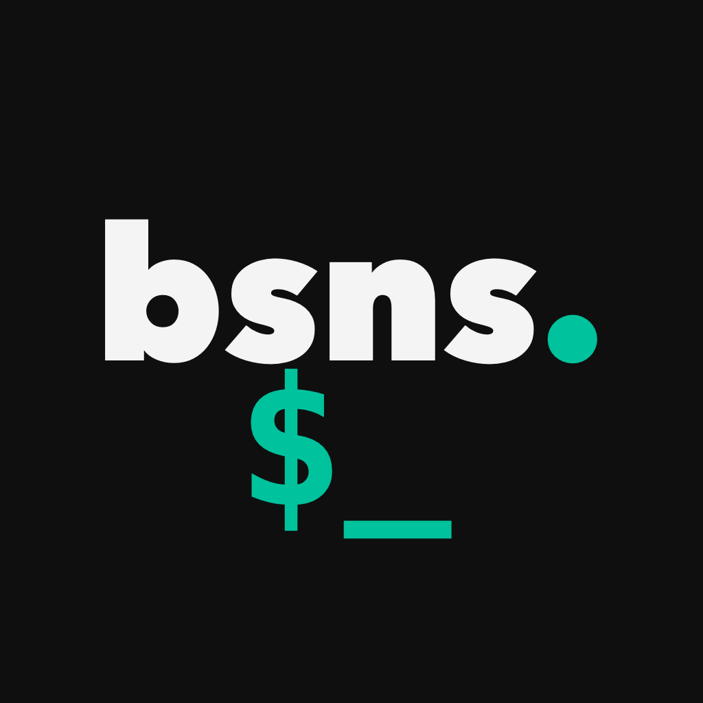
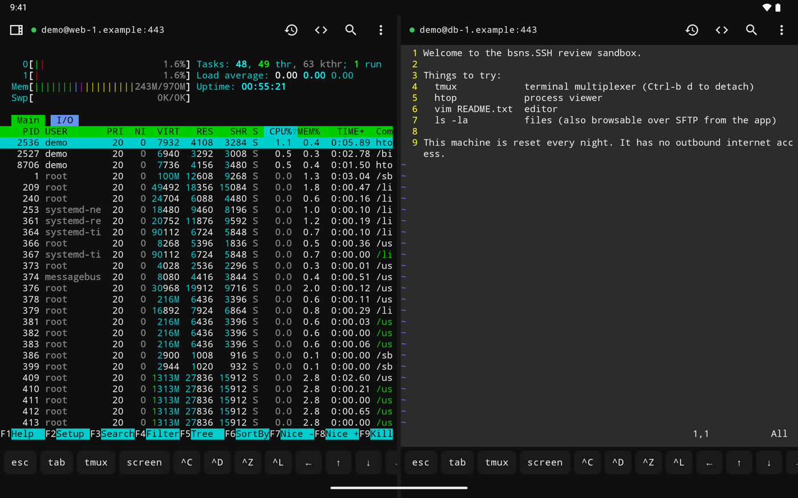
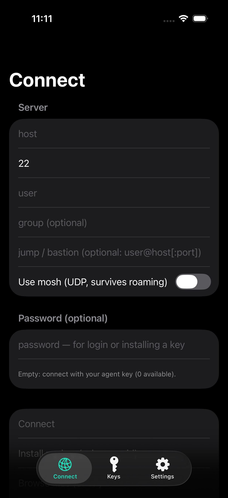
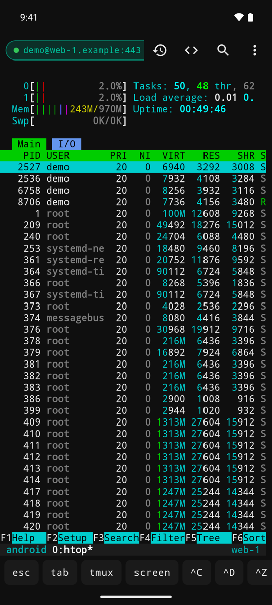
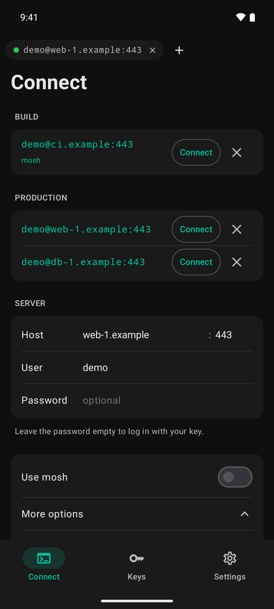

<p align="center">
  
</p>

<h1 align="center">bsns.SSH</h1>

<p align="center">
  <strong>The SSH client whose keys can't be stolen, because they can't be copied.</strong><br>
  Native for iPhone, iPad, Android phones and tablets, and the Mac.
  Free and open source: no ads, no account, no telemetry, no catch.
</p>

<p align="center">
  <strong>Coming soon to the App Store and Google Play.</strong>
</p>

<p align="center">
  
</p>
<p align="center">
  
  
  
</p>

---

## Why it's different

- **Keys that live in hardware.** Your SSH key is generated inside the Secure
  Enclave (iPhone, iPad, Mac) or the Android Keystore (StrongBox or TEE; the app
  shows which), or it stays on a FIDO2 security key or PIV smart card over NFC or
  USB-C. It never leaves that hardware. Every login signs through a built-in SSH
  agent, so even the networking code never sees a private key.
- **Your phone as a security key** (iPhone + Mac). Pair the Mac app and your
  Mac's `ssh`, `git`, and `scp` sign with the key on your phone. Each request
  shows up on the phone for approval.
- **Every machine at a glance** (iPhone, iPad, Mac). The Machines view lists every
  tmux window on every host, shows what each one is doing, and flags the ones
  waiting for you. A local notification tells you when one needs attention.
- **Sessions that follow you** (iPhone, iPad, Mac). Hand a tmux session from one
  device to another, and let Workspaces restore a project's windows on the host
  after a reboot. Mosh keeps sessions alive across network changes and sleep.
- **Built for big screens.** On iPad and on Android tablets, Chromebooks, and
  foldables, a sidebar keeps your sessions one tap away, two terminals sit side
  by side, and hardware-keyboard shortcuts cover the session controls.
- **Sync without a vendor.** Hosts, keys, and workspaces sync through a folder you
  choose, via the system file picker: iCloud Drive, Google Drive, Dropbox,
  Nextcloud, or a network share. The app gets no API tokens, and everything is
  encrypted on your device first, so the storage only ever sees ciphertext. There
  is no bsns server and no account.
- **Private, and you can check.** No analytics, no crash reporting, no ads. The
  app connects only to your servers and the storage you pick. On Apple devices,
  pairing for phone-as-a-key adds a direct encrypted connection between your
  devices, and background questions and notices travel as encrypted records in
  your private iCloud database with Apple push notifications. See the
  [Privacy Policy](PRIVACY.md) and the
  [network verification guide](docs/no-telemetry-verification.md) for checks you
  can run yourself.

## Features

| | iPhone | iPad | Android | Mac (preview) |
|---|:-:|:-:|:-:|:-:|
| Non-exportable hardware device key | Secure Enclave | Secure Enclave | Keystore | Secure Enclave |
| FIDO2 security keys (`sk-`), PIV smart cards | ✓ | ✓ | ✓ | |
| Key or password login, one-tap "install my key" | ✓ | ✓ | ✓ | ✓ |
| Tabs, find in output, shortcut key bar | ✓ | ✓ | ✓ | ✓ |
| mosh with automatic reconnect | ✓ | ✓ | ✓ | ✓ |
| SFTP, local port forwarding, jump hosts | ✓ | ✓ | ✓ | ✓ |
| Import `~/.ssh` config, known_hosts, and keys | ✓ | ✓ | ✓ | ✓ |
| Encrypted sync to storage you choose | ✓ | ✓ | ✓ | ✓ |
| Sidebar layout, two sessions side by side | | ✓ | tablets | sidebar |
| Hardware-keyboard shortcuts | ✓ | ✓ | ✓ | ✓ |
| Machines view: every tmux window, what's waiting | ✓ | ✓ | | ✓ |
| Session handoff and Workspaces | ✓ | ✓ | | ✓ |
| tmux panel: native, searchable scrollback | ✓ | ✓ | | ✓ |
| Shortcuts and Siri actions | ✓ | ✓ | | |
| Phone as a hardware key for your Mac | ✓ | | | ✓ |

Accessibility: VoiceOver-labeled controls, Dynamic Type, and a high-contrast dark
palette across the UI. A VoiceOver-readable *terminal* is on the roadmap.

## Under the hood

SSH runs on libssh2 1.11 with OpenSSL 3.5, built from checksum-verified, pinned
source on every platform, and with a modern-only algorithm policy (no SHA-1, CBC,
or 3DES). Host keys are pinned on first use and re-checked on every connection
and reconnect, including through a jump host. Config sync uses PBKDF2-SHA256 and
AES-256-GCM from the system crypto libraries.

See [Getting started](docs/getting-started.md) for your first connection and
[shared workspace setup](host/README.md) for host-side tmux recovery.

## Known issues

- **mosh display after a long background/resume.** If a mosh session is
  backgrounded long enough to lose its network path (e.g. on a VPN/tailnet) and
  then resumed, a full-screen TUI such as `tmux` can occasionally come back with
  a misplaced cursor or a stale-looking redraw. The session reconnects and stays
  usable, and a manual window resize forces a clean repaint. Plain SSH is
  unaffected — mosh is the optional roaming transport; SSH is the default.

## Building

The device-independent core (key handling, SSH agent, wire codec, crypto
envelope) builds and tests with no device — and is held byte-identical across
platforms by shared parity vectors:

```sh
swift test                            # iOS/macOS core (Swift)
cd android && ./gradlew :core:test    # Android core (Kotlin)
```

The **macOS** app target lives under `mac/` (also generated by XcodeGen).
Build it with `mac/build.sh`; the script gives each build a UTC timestamp in
About bsns.SSH so installed copies can be distinguished.
The **iOS** app target lives under `app/` (generated by XcodeGen); the **Android**
app under `android/` (Gradle, with the libssh2 / OpenSSL / mosh transport built
from source via the NDK). See [docs/ARCHITECTURE.md](docs/ARCHITECTURE.md) for the
layout and [android/README.md](android/README.md) for the Android modules.

## Why is this free?

bsns.SSH is built and maintained by [bsns.cc](https://bsns.cc), an operations
platform for operators. We build and run on these tools ourselves, and we think
foundational admin and security tooling should be open, private, and free. No
catch: the app has no analytics, no ads, and never upsells inside the app —
it's free and open-source as a showcase of how we build. If it earns your trust,
bsns.cc is where the rest of our work lives.

## License

[GPLv3](LICENSE). The app links [mosh](https://mosh.org) (GPL-3.0), so the
combined work is GPLv3. See [THIRD-PARTY-NOTICES.md](THIRD-PARTY-NOTICES.md) for
the full dependency stack and mosh's App Store distribution exception.
